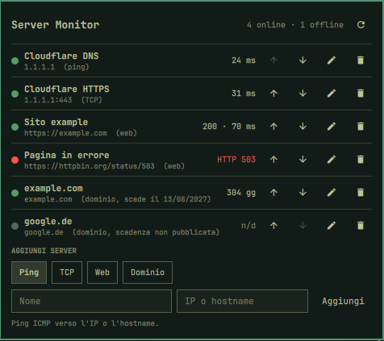

# Omarchy Server Monitor

🇬🇧 English · 🇮🇹 [Italiano](README.it.md)

A bar widget for Omarchy 4.x that checks whether your servers, websites and domains are reachable and shows each one with a green (ok) or red (problem) dot.



> The widget's interface is in Italian.

## Features

- Bar icon with the number of servers online, e.g. `󰒍 2/3`. When at least one server is offline the icon takes the theme's alert color.
- Popup with the list: status dot, name, address, check type and result (latency, HTTP status or days to expiry).
- Add, edit, reorder and remove entries directly from the popup.
- Four kinds of check:
  - **Ping**: ICMP ping to an IP or hostname;
  - **TCP**: connection to a port, useful for servers that block ping;
  - **Web**: HTTP/HTTPS request to a URL; green for a 2xx or 3xx answer, with status code and response time;
  - **Domain** ("Dominio"): days until the domain registration expires, read from RDAP with a whois fallback; red when fewer than 30 days are left (configurable) or the domain has expired.
- All entries are checked in parallel, automatically every 60 seconds (configurable). Domain expiry is looked up every 6 hours, or immediately with a manual check.
- Desktop notification when an entry goes down, comes back, or a domain gets close to expiry (can be turned off).
- Look and colors follow the active Omarchy theme: the green and red dots are the `green` and `red` keys of the theme's `colors.toml` and change along with the theme.

## Requirements

- Omarchy 4.x with Omarchy Shell (Quickshell).
- `bash`, `ping` (iputils), `timeout` (coreutils), `curl`, `jq` and `notify-send` (libnotify), all of which ship with Omarchy.
- Optional: `whois`, used for domain expiry when a registry has no RDAP service (e.g. `.it`). Install it with `omarchy pkg add whois` if it is missing.

## Install

```bash
omarchy plugin add https://github.com/GiuseppeSolla/omarchy-server-monitor.git --enable
```

The widget is placed in the right section of the bar. To move it:

```bash
omarchy bar move mcp64.server-monitor --section left   # or center
```

### Manual install

```bash
git clone https://github.com/GiuseppeSolla/omarchy-server-monitor.git \
  ~/.config/omarchy/plugins/mcp64.server-monitor
omarchy-shell shell rescanPlugins
omarchy plugin enable mcp64.server-monitor
```

## Usage

The labels in brackets are the Italian ones shown in the widget.

- **Left click** on the icon: open or close the popup.
- **Middle click**: check all servers now.
- **Add a server** ("Aggiungi server"): pick the check type (Ping, TCP, Web, Dominio), enter a name ("Nome") and the address (IP or hostname, URL or domain; for TCP also the port, "Porta"), then press Enter or "Aggiungi".
- 󰏫 **Edit** ("Modifica"): loads the server into the form below; "Salva" saves it, 󰅖 or Esc cancel.
- 󰁝 / 󰁅 **Reorder**: move the server up or down the list.
- 󰆴 **Remove** ("Rimuovi"): deletes the server from the list.
- 󰑐 in the header: check all servers now.

## Configuration

The server list is stored in `~/.config/omarchy/server-monitor.json`:

```json
[
  { "name": "Cloudflare DNS", "type": "ping", "host": "1.1.1.1", "port": 0 },
  { "name": "Cloudflare HTTPS", "type": "tcp", "host": "1.1.1.1", "port": 443 },
  { "name": "Website", "type": "http", "host": "https://example.com", "port": 0 },
  { "name": "example.com", "type": "domain", "host": "example.com", "port": 0 }
]
```

`type` is `ping`, `tcp`, `http` or `domain`; `port` is used only by `tcp`. Entries without `type`, written by version 1.0, are read as `tcp` when they have a port and `ping` otherwise. You can also edit the file by hand: the popup updates on its own.

Widget options (in `~/.config/omarchy/shell.json`, on the widget's entry):

| Key           | Default | Description                                    |
|---------------|---------|------------------------------------------------|
| `intervalSec` | `60`    | Seconds between checks (10–3600)               |
| `notify`      | `true`  | Notify when a server changes state             |
| `domainWarnDays` | `30` | A domain turns red when its registration expires in fewer than this many days (0–365) |

Example:

```json
{ "id": "mcp64.server-monitor", "intervalSec": 30, "notify": false }
```

## Remove

```bash
omarchy plugin remove mcp64.server-monitor
```

The server list in `~/.config/omarchy/server-monitor.json` is not deleted.

## Limits

- Ping waits at most 2 seconds, the TCP connection at most 3, a web request at most 10 (following up to 5 redirects).
- A web address without `http://` or `https://` is checked over HTTPS.
- Domain expiry uses the public RDAP service at `rdap.org` and, as a fallback, `whois`, so the domain names you monitor are sent to those services. Some registries (e.g. `.de`) do not publish the expiry date: the dot then stays grey and shows "n/d". Subdomains are reduced to the registered domain (`www.example.co.uk` → `example.co.uk`).
- A server that only answers over IPv6 must be entered with its IPv6 address; checks use `ping` and bash's `/dev/tcp`, so they follow the system's network configuration.

## License

MIT. See [LICENSE](LICENSE).
